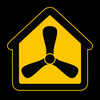

# Plugin icon

A modern three-blade fan inside a house, with a yellow interior, black exterior, and thin yellow border.

| File | Dimensions | Use |
| --- | --- | --- |
| [homebridge-bigassfans.png](homebridge-bigassfans.png) | 100 × 100 | Homebridge plugin icon request |
| [homebridge-bigassfans-512.png](homebridge-bigassfans-512.png) | 512 × 512 | Larger preview |

Both files are square PNG images with opaque backgrounds.

The [Homebridge plugin icon request](https://github.com/homebridge/plugins/blob/latest/.github/ISSUE_TEMPLATE/2_icon-request.yml) accepts a square PNG around 100 × 100 pixels. The plugin must be verified, and its developer must submit the request. Attach `homebridge-bigassfans.png` when requesting this artwork. Adding the file to this repository does not automatically update the icon in Homebridge.
