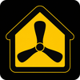

# Plugin icon

A modern three-blade fan inside a house, with a yellow interior, black exterior, and thin yellow border.

| Style | 100 × 100 PNG | 512 × 512 PNG |
| --- | --- | --- |
| Rounded corners | [Homebridge size](homebridge-bigassfans-rounded.png) | [Larger preview](homebridge-bigassfans-rounded-512.png) |
| Square corners | [Homebridge size](homebridge-bigassfans.png) | [Larger preview](homebridge-bigassfans-512.png) |

All files have square image dimensions. The rounded version has a subtle 8% corner radius with transparency only at the four outer corners. Its artwork and black background are fully opaque. The square-corner version is fully opaque throughout.

The [Homebridge plugin icon request](https://github.com/homebridge/plugins/blob/latest/.github/ISSUE_TEMPLATE/2_icon-request.yml) accepts a square PNG around 100 × 100 pixels. The plugin must be verified, and its developer must submit the request. Attach either 100 × 100 PNG when requesting this artwork. Adding the file to this repository does not automatically update the icon in Homebridge.
